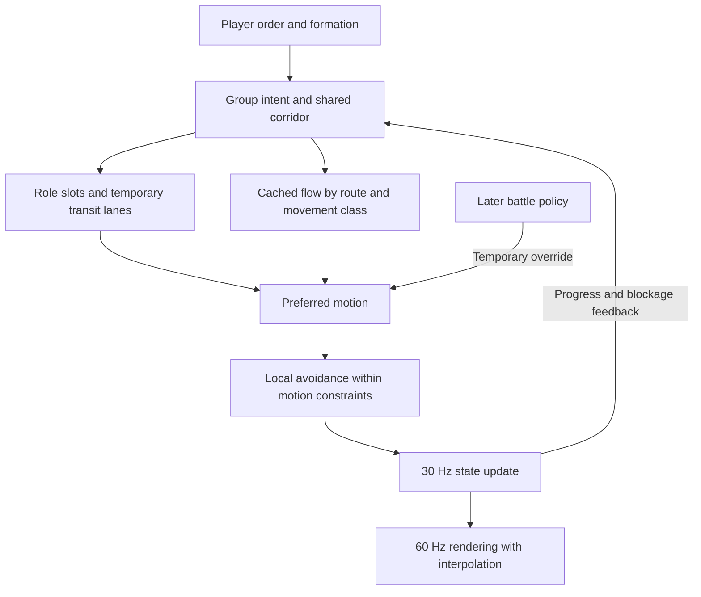

# Unit formations and group movement for a large-scale RTS

Research report · 2 November 2026 · Design target: at least 2,000 active units, 60 fps rendering, 30 Hz simulation

## Executive summary

1. **Keep your flow fields and add a soft formation layer.** Route the group through traversable space, preserve a useful arrangement where space permits, and recover destination slots when reachable. Age of Empires IV documents a combination of hierarchical routing, flow fields and steering; formations do not require replacing the navigation foundation. [GDC session](https://www.gdcvault.com/play/1027659/Pathing-in-Age-of-Empires)
2. **Responsiveness should outrank perfect shape.** Age of Empires II DE added an explicit escape move that prioritizes travel over assembling. Make urgent movement possible without regrouping first. [Update 153015](https://www.ageofempires.com/news/age-of-empires-ii-definitive-edition-update-153015/)
3. **Red Alert 2 is a responsiveness reference, not a formation-menu reference.** Its contemporary review explicitly reports the absence of preset formations. Borrow its directness while adding optional organization. [GameSpot review](https://www.gamespot.com/reviews/command-and-conquer-red-alert-2-review/1900-2646216/)
4. **Ship a small, useful set:** Auto, Line, Column, Armoured and Drawn Front. Treat loose spacing and cohesion as independent options. This is a proposal; a wedge adds little unless your combat mechanics make it useful.
5. **Separate geometry from roles.** “Front”, “fire support”, “flank” and “protected support” are tactical roles; footprint is a packing constraint. One block per footprint alone cannot express a mixed armoured formation.
6. **Treat formation as intent, not a rigid object.** Let width shrink, lanes form, and temporarily separated subgroups rejoin. A bridge can carry a column; it cannot carry a wide rectangle simply because its centre has a path.
7. **Keep assignment stable.** Preserve lateral order and compatible slots; make bounded local repairs after losses or obstructions. Reassigning everyone repeatedly causes crossings, hesitation and arrival shuffling.
8. **Use sorted assignment by default.** Reserve Hungarian matching for small, infrequent subproblems. Its conventional dense form costs O(n³) time and O(n²) storage; it minimizes an assignment cost, not collision-free travel time. See §5 for sources and limits.
9. **Slowest-unit pacing needs exceptions.** Use sustainable speed for the participating cohort, gradual catch-up within each unit’s real limits, and explicit treatment of blocked or detached stragglers. Do not let one immobilized unit freeze hundreds indefinitely.
10. **Distinguish destination gestures.** A facing arrow, a front-width drag and a freehand path communicate different things. Show the formation preview before committing; make Drawn Front unmistakably a destination layout.
11. **ORCA is local avoidance, not a complete traffic manager.** It does not by itself choose bridge entry order, reserve destination space or guarantee progress in dense opposing crowds. Its published performance is encouraging, but is not a benchmark of this game. See §5.
12. **A 30 Hz tick does not ensure determinism or 60 fps.** Stable ordering, arithmetic, random streams and job-result commits matter. Test frame spikes and simultaneous new orders, not only average steady-state movement.
13. **Reserve battle hooks now, implement tactics later.** Store role-aware slots, movement and combat facing separately, stance policy, engagement leashes, suspended orders and re-form state. Combat should temporarily override movement intent through a clear interface.
14. **Do not promise the hardware target from research alone.** The proposed design avoids obvious scaling traps; an integrated benchmark on a specified six-core CPU and RTX 3050 6 GB must establish whether 2,000 active units actually meet the target.

## Scope and evidence conventions

**Documented** means a shipped-game manual, developer explanation, official patch note or primary research source supports the claim. **Reported** means a review or community observation; it is evidence of an experience, not a measured consensus. **Common practice** identifies a recurring engineering pattern rather than a claim about every game. **Proposed** means a design recommendation for this project. Mathematical estimates are marked **derived**.

All tuning numbers in recommendations are starting hypotheses, not recovered commercial-game constants. Historical manuals establish their own editions; patches and community forks may differ. “Not verified” means the reviewed evidence was insufficient, not proof that a feature cannot exist. This report does not claim hands-on testing of the games or a fresh benchmark. Public sources seldom expose exact formation assignment code, spacing or re-form timers.

The relevant scale is **independently simulated entities**, not the number of animated soldiers on screen. A Total War regiment, a Company of Heroes squad and an individually selectable C&C tank operate at different command levels. Their interfaces are useful references; their visible army sizes are not directly comparable performance results.

## Part A — Formations for movement

## 1. Shipped-game survey

The comparison separates **formation geometry**, **movement cohesion**, and **combat autonomy**. A saved control group merely recalls a selection; it does not necessarily save a shape. “No palette documented” is deliberately narrower than claiming there is no formation-related code. Reception below is attributed to particular reviews or discussions, not presented as a player consensus. Historical complaints are dated and may have been patched.

### 1.1 Classic RTS and large-army references

| Game / edition | Formations, selection and default | Movement limits and reception |
|---|---|---|
| **Red Alert 2 / Yuri's Revenge** | No selectable preset formations. Ordinary group orders, waypoints, Guard, Escort and Scatter organize independent units. **F follows a unit with the camera**; RA1's F formation command must not be imported into RA2. [RA2 manual](https://manualmachine.com/gamespc/commandconquerredalert2/1117998-user-manual/), [YR manual](https://oldgamesdownload.com/manual/command-conquer-yuri-s-revenge-windows-manual-english/) | GameSpot explicitly noted absent presets while praising easy group movement, generally competent navigation and responsiveness. Its qualification was that coordinating waypoint plans could be impractical during fighting. This is the project's reference for direct control, not evidence that formations are necessary for classic C&C play. [Contemporary review](https://www.gamespot.com/reviews/command-and-conquer-red-alert-2-review/1900-2646216/) |
| **C&C3: Tiberium Wars / Kane's Wrath** | Adjustable rank layouts rather than a documented named line/wedge menu. Hold **both mouse buttons** at destination: horizontal motion rotates, vertical motion changes width/depth; release commits. Formation move uses the slowest selected unit's pace. Ordinary right-click remains available; Guard is the default combat stance. [EA manual](https://static.wikia.nocookie.net/cnc_gamepedia_en/images/8/8b/CCUC-CNC3-pcMANOLeUS.pdf/revision/latest) | The manual promises paced travel and the final arrangement, not perfect rigidity around terrain. A contemporary guide praised the revised controls after an adjustment period; discussion shows players discovering formation move late and asking whether shape persists during travel. Two-button preview is capable but needs teaching. [Guide](https://gamefaqs.gamespot.com/pc/932602-command-and-conquer-3-tiberium-wars/faqs/48013), [discussion](https://gamefaqs.gamespot.com/boards/932602-command-and-conquer-3-tiberium-wars/41582720) |
| **Supreme Commander / Forged Alliance** | Hold RMB for preview, move to orient, click LMB to cycle layouts, release to order. Ordinary moves and explicit formation moves coexist. Current **FAF** code has broad Attack and deeper Growth layout families, with direct-fire, artillery, AA, shield and utility priorities; those are internal names, not an AoE-style named palette. [FA manual](https://ftp.zx.net.nz/pub/Game-Files/SupCom/ForgedAlliance/doc/manual/supcom_manual_uk.pdf), [FAF source](https://github.com/FAForever/fa/blob/develop/lua/formations.lua) | Formation travel can gather first and slow the group. FAF discussion values shielding/mixed-speed cohesion and sometimes reduced bumping, but also criticizes assembly delays. **Version trap:** vanilla FA's Ctrl+RMB shortcut was reportedly removed in FAF; hold RMB is the current documented community route. Do not equate original/FA navigation with SupCom2 flow fields. [FAF discussion](https://forum.faforever.com/topic/9059/about-formation-move), [developer account](https://www.gameaipro.com/GameAIPro/GameAIPro_Chapter23_Crowd_Pathfinding_and_Steering_Using_Flow_Field_Tiles.pdf) |
| **Beyond All Reason** | RMB-drag draws a custom destination line; units spread along it. Alt-move creates a class-sensitive arrangement; Ctrl-move preserves formation at slowest-unit speed. Ordinary move remains the default basic order. The official detailed description says Alt-move uses each unit's own maximum speed, despite a misleading “fastest unit” summary. [Official commands](https://www.beyondallreason.info/commands-20) | Drawing is widely useful for frontage and splash spacing; a FAF community request specifically praises its feel. A **2024 issue report** documents Fight-drag/cancel conflicts and awkward chaining, demonstrating gesture ambiguity rather than proving a current bug. March 2026 added relative-position guard movement, addressed in Part B. [Cross-game praise](https://forum.faforever.com/topic/5951/ui-mod-request-feature-from-bar-move-line-drag/2), [historical issue](https://github.com/beyond-all-reason/Beyond-All-Reason/issues/3400) |
| **Age of Empires II: Definitive Edition** | Four standard choices: **Line, Box, Staggered and Flank/Split**, selected with command buttons or hotkeys. Line is the normal default; tougher/melee classes lead, vulnerable classes follow or occupy the box interior. Line travel may become column-like over distance; this is not a separate standard Column button. [Formation reference](https://ageofempires.fandom.com/wiki/Unit_formation) | The original game's review praised logical placement and shared pace. DE patches reveal the cost of mandatory regrouping: **August 2025 Update 153015** introduced Ctrl+RMB escape movement that prioritizes travel over assembling, alongside fixes for front units regrouping before advancing. This is a dated shipped improvement, not a claim that the listed build is today's newest. [Original review](https://www.gamespot.com/reviews/age-of-empires-ii-the-age-of-kings-review/1900-2537995/), [official patch](https://www.ageofempires.com/news/age-of-empires-ii-definitive-edition-update-153015/) |
| **Age of Empires IV** | Automatic mixed-unit arrangement plus **Line, Wedge and Staggered** choices via command UI/hotkeys; right-drag sets destination orientation. Nearby military units coordinate travel, with slow units affecting pace. Ground Column is not verified here. **Naval** Line/Column/Staggered are explicitly documented in Season Ten. [Formation reference](https://ageofempires.fandom.com/wiki/Unit_formation), [naval patch](https://www.ageofempires.com/news/age-of-empires-iv-season-ten-update-13-0-4178/) | Players describe practical value in line frontage and staggered anti-splash spacing, while others leave the automatic arrangement alone. A 2023 public-test discussion criticized delayed drag recognition. These reports support a small useful palette and responsive preview, not a universal claim that wedge is useless. [Usage discussion](https://forums.ageofempires.com/t/how-do-you-use-army-formation/203933), [input report](https://forums.ageofempires.com/t/pup-right-click-and-drag-formations-no-longer-working/222745) |
| **StarCraft II — contrast** | No comparable player-facing formation-template palette. Players position through selection, move/attack-move and repeated micro. Blizzard teaches **concaves, surrounds, balls and spreading** as tactical arrangements; those terms do not imply selectable presets. “No formations” should mean no such command palette, not no group-movement behaviour. [Official positioning guide](https://news.blizzard.com/en-us/article/6640646/game-guide-unit-positioning) | Players repeatedly praise responsiveness and direct control; other discussion criticizes clumping and the consequences of deathballs. These are trade-offs of the experience, not proof of its unpublished assignment algorithm. Blizzard itself warns that dense balls are splash-vulnerable and concaves can be flanked. [Responsiveness discussion](https://www.reddit.com/r/starcraft2/comments/1pbsyl0/rts_dev_here_huge_sc2_fan_what_23_things_make_sc/), [pathfinding trade-off discussion](https://www.reddit.com/r/FrostGiant/comments/twkwjh) |
| **Warcraft III — additional precedent** | Automatic formation movement puts melee ahead of ranged, then casters/siege; units may pause for slower members. The original official guide gives **Alt+RMB** to bypass formation and travel at best speed. This is automatic role organization with an escape hatch, not many geometric presets. [Official commands](https://classic.battle.net/war3/basics/specialcommands.shtml) | The stated benefit is cohesive arrival; community requests to remove the formation toggle complain about stopping and slowing units. Treat that as an individual preference. Its original 12-unit selection limit makes it an interface precedent, not direct performance evidence for hundreds per group. [Community feedback](https://us.forums.blizzard.com/en/warcraft3/t/patch-300-suggestions/37928) |

### 1.2 Squad and battlefield tactics references

| Game / edition | Formations, selection and default | Movement limits and reception |
|---|---|---|
| **Company of Heroes 1** | Automatic **within-squad** leader/core/flank arrangement, softened by terrain and cover. Right-drag sets facing; absent explicit facing, the developer account describes threat/movement-derived heading. No verified army-wide line/column palette. Several selected squads remain a different control level from one squad's soldiers. [Developer chapter](https://forum.arongranberg.com/uploads/short-url/rWod3K2KhNWcOEdjewnsLXQKU6A.pdf) | Arrival reservations and local cover placement differ from transit following. The contemporary review praised cover-to-cover infantry and intuitive tactical manoeuvres. Its success supports believable local adaptation; it does not establish that every soldier should run an equally expensive local search at this project's scale. [Review](https://www.gamespot.com/reviews/company-of-heroes-review/1900-6157430/) |
| **Company of Heroes 2** | Automatic squad placement, cover and firing arcs dominate. RMB-drag issues facing; Attack Move, Retreat and Reverse are explicit actions. Most units fire automatically in range; some have Hold Fire. No army-template palette is documented. Classic/Grid controls differ. [Official manual](https://www.feralinteractive.com/en/manuals/companyofheroes2/latest/steam/) | A launch review praised tactical freedom and tense multiplayer but reported blocked troops and vehicles exposing rear armour during movement. These are historical examples of navigation errors undermining tactical intent. CoH1's published internal algorithm must not be silently attributed to CoH2. [Review](https://www.pcgamer.com/company-of-heroes-2-review/) |
| **Total War: Shogun 2, with Rome II continuity** | Regiments already have ranks; selected groups can use **Spear Point, Crane's Wing, Flying Geese, Reclining Dragon, War of the Tiger, Bark of the Pine Tree, Cloud Dragon and Flying Bird**. Shogun 2 exposes group presets, G grouping, Ctrl+G locking and rank/file controls. Ordinary groups and locked formations differ. [Manual](https://www.feralinteractive.com/en/manuals/shogun2tw/latest/linux/) | Locked groups preserve their layout while moving; preset templates place classes in designated blocks. Rome II also documents group locking/presets. Community criticism favours simple lines and separate cavalry control over elaborate presets whose staggered advance can isolate troops. Unit-specific loose/wedge abilities are another layer. [Rome II groups](https://r2enc.totalwar.com/en/manual/single-player/0082_enc_page_battle_play_phase_conflict_groups/), [Shogun discussion](https://steamcommunity.com/app/34330/discussions/0/595136186401447503/) |
| **Total War: Warhammer series through III** | The useful transferable controls are **right-drag frontage**, translating a selection while keeping relative placement, and soft versus locked groups. WHIII documents G soft group/Ctrl+G hard group. Do not assume Shogun's eight templates or every historical unit stance survive unchanged; WH1's smaller melee-front/missile-front palette is separately documented. [Academy controls](https://academy.totalwar.com/battle-keyboard-and-mouse-controls/), [WHIII hotkeys](https://news.xbox.com/en-us/2022/02/16/total-war-warhammer-3-hot-keys-revealed/amp/), [WH1 guide](https://primagames.com/gaming/total-war-warhammer-formation-control-guide-tips) | Community explanations value locked movement but reveal discoverability friction. WHIII **Hotfix 5.2.5** explicitly changed AI chokepoint behaviour under fire to prioritize getting through over re-forming. That is evidence for abandoning shape when necessary, not a guarantee of perfect player-controlled bridge traversal. [Discussion](https://www.reddit.com/r/totalwar/comments/1c8eawq/), [official hotfix](https://community.creative-assembly.com/total-war/total-war-warhammer/forums/7-total-war-warhammer/threads/7292-total-war-warhammer-iii-hotfix-5-2-5) |
| **Men of War / Assault Squad family** | Leader-following squads plus individual selection, contextual cover orders, turning and direct control. AS2 separates movement permission from fire permission. No named line/column/wedge palette was verified for original/AS2; do not borrow Men of War II's later/playtest features. Red Tide specifically documents RMB-drag facing. [AS2 manual](https://manualzz.com/doc/28280750/1c-company-assault-squad-2-men-of-war-user-manual), [Red Tide manual](https://images-na.ssl-images-amazon.com/images/I/B14SqN4CO3S.pdf) | Reviews praise combined-arms depth while criticizing meticulous micromanagement. The relevant lesson is that detailed individual agency and cover can overwhelm the player if group orders are unreliable; it is not evidence for an army-wide rigid formation system. [Assault Squad review](https://www.gamespot.com/reviews/men-of-war-assault-squad-review/1900-6310935/), [AS2 review](https://www.gamewatcher.com/men-of-war-assault-squad-2/review) |
| **Wargame: Red Dragon** | RMB moves/attacks; Move and Attack stops to engage, while Move Fast uses roads without stopping. “Display Formations” contains **regroup, split and spread** tools, not a documented line/wedge/armoured marching library. Same-type grouped units are distinct from numbered control groups. [Official manual](https://shared.cloudflare.steamstatic.com/store_item_assets/steam/apps/251060/manuals/WARGAME_RED-DRAGON_manuel_INT-digital.pdf?t=1725003090) | Community analysis identifies a concrete compromise: spreading reduces splash vulnerability but makes fitting a group inside cover harder. Recon, AA and logistics coordination generally remains the player's tactical responsibility; the reviewed evidence does not establish synchronized mixed-speed travel. [Community analysis](https://forum.quartertothree.com/t/wargame-red-dragon-fighting-a-land-war-in-asia/74089?page=8) |
| **WARNO** | A community guide documents RMB-drag destination arrangement: orientation and width/rows adapt to selection. **Smart Orders** such as seize/hold delegate tactics; configurable **Rules of Engagement** govern automatic reactions. Neither is synonymous with rigid geometry. Ordinary right-click behaviour depends on ROE; avoid treating one guide's Hunt default as universal. [Guide](https://steamcommunity.com/sharedfiles/filedetails/?id=2727549821), [developer announcement](https://steamcommunity.com/games/1611600/announcements/detail/5918290951278876984) | Early-access coverage found pathfinding generally competent and Smart Orders useful. Dated player reports complain that faster IFVs leave infantry behind, distinguishing destination layout from shared-speed travel. A Total War-style transit lock is not verified here. [Review](https://www.superjumpmagazine.com/warno-early-access-impressions/), [2024 discussion](https://www.reddit.com/r/warno/comments/1c8m2k5/) |

### 1.3 Space and console references

| Game / edition | Formations, selection and default | Movement limits and reception |
|---|---|---|
| **Homeworld classic; Remastered separately** | Classic offers **Delta, Broad, X, Claw, Wall, Sphere and Custom** through menu/F5–F11 or cycling. Custom captures manually positioned ships; new ships use Military Parade. Tactics are separate, with Neutral normal. This is a verified saved-arrangement precedent. [Original manual](https://www.homeworldarchives.com/media/Homeworld-Manual-HW1-ver1.pdf) | Remastered launch reviews criticized lost formation behaviour and supports racing ahead. **2016 patch 2.0** subsequently rewrote formations, added combat subgroups/caps and separated stance from engagement rules. Do not use launch criticism as a description of the patched version. [Review](https://www.destructoid.com/reviews/review-homeworld-remastered-collection/), [official 2.0 notes](https://store.steampowered.com/news/posts/?appgroupname=Homeworld+Remastered+Collection&appids=244160&enddate=1465574896) |
| **Homeworld 3 — additional lesson** | Formation changes interact with ongoing orders. Following demo feedback, the developer changed assembly so ships could continue their tasks and a travelling group used its furthest-ahead ship as anchor, reducing backward regrouping. This is a separately versioned successor, not proof of classic behaviour. [Developer update](https://steamcommunity.com/games/1840080/announcements/detail/4145073329281827772) | The same official update records complaints about unintuitive controls, tedious formation creation and ships stopping when assigned formations. It gives unusually direct evidence that **mid-move rearrangement should preserve useful progress**. Later combat changes are discussed in Part B. |
| **Halo Wars, original 2009** | No selectable geometric formation palette is documented. Controller commands emphasize A selection/paint-selection, bumpers for local/global selection, trigger cycling by type, and contextual X orders. Units automatically engage nearby enemies. Definitive Edition PC bindings are a separate interface. [Original manual](https://www.halopedia.org/images/4/4d/HW_Manual.pdf?7c99b=) | A contemporary review praised quick mass commands and navigation but criticized subtle multi-force control and picking individual units during battle. This supports keeping the common order simple while providing effective mixed-type subselection. It does not establish class-sorted army layouts or slowest-unit pacing. [Review](https://worthplaying.com/article/2009/3/2/reviews/59449-xbox-360-review-halo-wars/) |

Across these references, the clearest recurring distinction is **“arrive arranged” versus “travel together.”** The interface should expose which promise it makes. Automatic role placement, explicit facing, formation retention and permission to pursue are separate choices even when a particular game packages them together. Exact commercial spacing constants, slot solvers and reform timers are usually unpublished; the later recommendations therefore label their own numbers as proposals.

### 1.4 Two edition details worth retaining

**AoE II DE:** Update 107882 changed Line's transition to marching column from move/attack-move distances over **10 tiles** to over **30 tiles**; Patrol retained column behaviour regardless of distance. This is a concrete historical threshold change, not a general rule to copy into a different map scale. [Official patch](https://www.ageofempires.com/news/age-of-empires-ii-definitive-edition-update-107882/)

**Warhammer III:** its pre-release developer feature list described dragging a mixed selection into a simple melee-before-ranged arrangement, and remembering an army's deployment for its next standard campaign field battle. The original page was inaccessible during this research; the developer bullet list is reproduced by [Pro Game Guides](https://progameguides.com/total-war-warhammer-iii/total-war-warhammer-3-will-include-a-host-of-quality-of-life-improvements/). Later players report inconsistent deployment recall, so distinguish that feature from a robust, user-named preset library. [Dated player discussion](https://www.reddit.com/r/totalwar/comments/1c1bf5w/)

## 2. Controls: fast orders with predictable intent

### 2.1 What the references establish

**Documented:** C&C3 uses a two-button formation preview; Total War exposes direct front-width placement and group manipulation; BAR supports drawing destination lines. These are distinct interaction models, not interchangeable versions of right-drag. See the edition-specific sources in §1.

**Reported:** an AoE IV public-test discussion describes a drag recognition delay measured by one participant at about **200 ms**, while another perceived considerably more delay. This is useful evidence that gesture thresholds affect feel, not an authoritative measurement of every release. [AoE IV input discussion](https://forums.ageofempires.com/t/pup-right-click-and-drag-formations-no-longer-working/222745)

No comparative usability study reviewed here establishes a universal fastest scheme. The following ranking is **proposed**, based on number of actions, ambiguity and the cited experiences:

| Control | Best use | Speed and error trade-off |
|---|---|---|
| Ordinary right-click | Most movement orders | One familiar action; preserve Auto or the group’s explicit chosen formation |
| Right-drag a straight frontage | Set destination width and facing together | Direct and previewable; endpoint direction must be taught clearly |
| Facing-only modifier + right-drag | Rotate a fixed-width layout | Avoids accidental width changes; requires learning one modifier |
| Dedicated Drawn Front action + drag | Curves, ridgelines, wrapping a defensive position | Expressive, but costs attention and needs invalid-geometry feedback |
| Dedicated formation hotkeys | Switch Line/Column/Armoured while moving | Faster than cycling; visible active state and rebinding are essential |
| Cycle one formation key | Controller or low-frequency use | Easy to expose; poor when the player must count presses under pressure |
| Save/apply preset | Repeated combined-arms layouts | Useful outside frantic combat; brittle if saved against exact unit identities |
| Both mouse buttons together | Expert C&C3-style preview | Proven precedent, but a less discoverable chord; offer as an alternate binding |

### 2.2 Recommended input contract — proposed

**Right-click ground:** issue Move immediately on release, with the existing or automatic shape. Clicking an enemy issues an explicit attack order; clicking a friendly target may issue guard/escort if supported. Never reinterpret an explicit attack as a formation gesture merely because the mouse twitched.

**Right-drag ground:** the drag segment is the **frontage**, from one end to the other. The arrow is perpendicular to that segment; choose its initial side toward the direction from the group to the destination. A visible flip action reverses facing without changing the front. Segment length sets width. This single segment supplies width and orientation, but cannot independently specify every facing preference, so the flip/facing-only actions are necessary.

**Facing-only drag:** retain width and use the cursor as an arrow from the destination centre. Label this as a separate action. Avoid one ambiguous gesture whose horizontal component sometimes means rotation and sometimes means width.

**Drawn Front:** a toolbar action and rebindable hotkey enter a temporary drawing mode. The stroke means “occupy this front”, not “travel along this route”. Show front-facing arrows, support ranks and blocked portions. A separate queued-waypoint mode handles routes. Simplify noisy strokes, reject self-intersections, and cap curvature where rear offsets would overlap. A short or impossible stroke adds ranks or shows overflow; it must not stack units invisibly.

Start testing with a **6–10 screen-pixel drag threshold**, scaled with UI/DPI, and immediate preview after crossing it. These are proposed values, not evidence-based universal optima. Measure accidental drags and extra corrective orders at different zoom levels. Avoid requiring a long hold before a deliberate drag; provide a user preference if motor accessibility needs a different threshold.

**Hotkeys:** dedicated actions for the five formations, spacing and cohesion; do not prescribe letters until the whole command map is reviewed. Preserve established attack-move, stop, hold and queue bindings. Tooltips must show the current binding, and mixed selections must display mixed states rather than a misleading single icon.

**Mid-move changes:** update desired shape without clearing the route or order queue. Retain feasible assignments; morph over time. A new destination or emergency move supersedes a pending re-form immediately. Formation controls should not inject a hidden Stop.

**Saved formations:** save a normalized shape, role zones, spacing, width policy and front—not unit IDs. Adapt to absent classes, extra units and different footprints. A separate “preserve current arrangement” snapshot can store offsets for the current membership. These are different features and should have different names.

Homeworld classic's Custom formation and Warhammer III's deployment recall provide distinct precedents: capturing an arrangement versus reusing a battle setup. Neither alone proves a general template editor that adapts cleanly to arbitrary future selections; that adaptation is part of the proposed design. [Homeworld manual](https://www.homeworldarchives.com/media/Homeworld-Manual-HW1-ver1.pdf), [reproduced Warhammer III developer notes](https://progameguides.com/total-war-warhammer-iii/total-war-warhammer-3-will-include-a-host-of-quality-of-life-improvements/)

**Mixed selections:** one order may contain multiple movement cohorts: ground, air, naval, or units lacking a common legal route. Show this in the preview. Existing named groups can keep their internal layouts under a higher-level move order; an arbitrary box selection should not silently erase persistent presets. New explicit orders to a subset detach that subset cleanly from its old movement group.

## 3. Automatic placement, spacing and shared pace

### 3.1 Use roles before packing — proposed

Your existing wide, shallow arrival blocks are a useful baseline. Add **role zones first**, then pack compatible footprints inside each zone. Keep the current preference for preserving relative position within a zone. Do not insist on preserving every old position if that would put repair vehicles at the front of an explicit Armoured formation.

| Unit type | Auto placement | Armoured placement | Important exception |
|---|---|---|---|
| General infantry | Forward or second-line band according to range and durability | Escort band behind armour; optional outer screen | Anti-tank, stealth, flamethrower and very short-range infantry need role overrides |
| Light vehicles | Outer forward shoulders or second line | Flanks and rear shoulders | Fast but fragile scouts should not be forced to absorb the first volley |
| Heavy armour | Front-centre combat band | Main front with room to turn and fire | Long-range tank destroyers may belong behind short-range assault tanks |
| Artillery | Rear fire-support band | Rear, with deployment and retreat clearance | Minimum range, setup time, firing arcs and line of fire matter more than the label “vehicle” |
| Anti-air | Distributed near valuable assets | Inner shoulders and support coverage | Use coverage and vulnerability; “all AA at the rear” can leave the front unprotected |
| Repair, healing, command and other support | Protected interior/rear | Protected middle-rear | Aura radius, repair reach and transport/unload space may require exceptions |

Use data tags such as `role`, `durabilityBand`, `preferredRange`, `minimumRange`, `footprint`, `turnModel`, `traversalMask`, `supportRadius` and `deploymentRequirement`. Unit-class defaults are authoring conveniences; explicit overrides handle unusual units. Keep combat-role decisions separate from visual size.

**Documented precedent:** Warcraft III describes melee at the front, followed by ranged units, then casters and siege, with optional formation bypass. This supports automatic roles, but its small selection groups do not establish scalability to hundreds. [Official controls guide](https://classic.battle.net/war3/basics/specialcommands.shtml)

### 3.2 Geometry and concrete starting values

**Proposed:** define spacing in world units relative to collision envelopes, not sprite dimensions or a single tank-width cell. For circular proxies, minimum centre separation is:

`separation(i,j) >= radius(i) + radius(j) + clearance(i,j)`

For rectangular vehicles, use orientation-dependent projected extents or a conservative navigation envelope. Spacing centres by the larger width is sufficient for the lateral extents of aligned units, but ignores vehicle length, changing orientation and swept turning clearance.

| Parameter | Proposed starting point | Reason / limit |
|---|---|---|
| Auto physical width:depth | **2:1**, adjustable roughly **1.5:1–3:1** | Preserves the existing shallow-block character; measure physical extents, not unit counts |
| Normal extra clearance | **10–25% of the larger unit’s collision diameter** | Test against turning and collision jitter; not a shipped-game constant |
| Loose mode | **1.5–2 times normal centre spacing** | Reduces density but increases terrain demands and can exceed support ranges |
| Line | Prefer **1–3 ranks per combat role band** where width permits | Hundreds of units may require additional ranks or separate sections |
| Column | As many lanes as the corridor safely fits | Single file only when necessary; maintain safe longitudinal gaps |
| Settlement tolerance | Initially **0.2–0.4 local slot spacings** | Stop harmless final shuffling; never use tolerance to accept physical overlap |

For homogeneous units with centre spacing `s`, a preliminary 2:1 grid has `columns ≈ ceil(sqrt(2n))`, then `rows = ceil(n / columns)`. Account for edge extents, unequal footprints and role bands before calling the physical ratio 2:1. For mixed units, estimate packed area and target `W ≈ sqrt(2A)`, `D ≈ sqrt(A/2)`, then perform actual row packing and legality checks. These are **derived initializers**, not packing guarantees.

For a drawn front, sample by **arc length** using each allocated unit’s required span. Pack each role band separately. Offset rear bands away from the facing normal, checking for overlap on tight curves. Avoid simply giving all units equally spaced points on a curve regardless of their size.

**Documented numerical example:** AoE IV’s Season One notes reduced warship formation spacing from **4.5 to 3 tiles**. This demonstrates that spacing is tuned by unit domain; it is not a transferable tank-spacing recommendation. [Official patch notes](https://www.ageofempires.com/news/age-of-empires-iv-season-one-update-release-notes/)

### 3.3 Pace, catch-up and stragglers — proposed

Separate **cruise pace** from **slot correction**. In a connected cohort, base cruise on the slowest member’s sustainable speed on the relevant terrain, including deployment or mobility constraints that actually apply. Faster members can close gaps at their normal maximum; the nominally slowest member has no spare speed unless the group slows temporarily. Avoid unconditional speed bonuses that change chase balance.

A useful conceptual control is `vPreferred = vCruise + boundedSlotCorrection`, capped by real speed, acceleration and turn limits before collision avoidance. Corrections should not pull front units backward toward an enemy during a retreat. Smooth group speed changes; avoid repeatedly stopping the whole group whenever one unit is a fraction outside tolerance.

Proposed straggler handling:

1. Measure progress along the route, not straight-line distance to a centroid across walls.
2. After **0.5–1.0 s** of no useful progress, try local recovery or release the blocked slot constraint.
3. After **2–3 s**, mark an unresolved unit as temporarily detached for pacing and offer a visible straggler indication. Its normal order remains active; it can rejoin at a feasible point.
4. Do not apply this timeout to units correctly waiting in an admitted bridge queue. A traffic queue is not a pathfinding failure.
5. Allow explicit **Together** and **Independent/Emergency** movement. Together waits more strongly; emergency movement releases shape and shared pace immediately.

These timers require playtesting across unit speeds and map scale. Use progress measured in body lengths as well as time, so slow artillery is not falsely declared stuck.

## 4. Formations during travel

### 4.1 Architecture comparison

| Approach | Strengths | Failure risks | Suitability here |
|---|---|---|---|
| Rigid virtual leader + fixed offsets | Clear facing, stable relative positions, cheap open-ground update | Leader fits while outer slots hit obstacles; turns demand impossible outer speeds; one blockage can stall everyone | Useful only in verified open space |
| Independent routing + arrival slots | Responsive routing; little transit coupling | Units arrive piecemeal, lose protection and can cross at destination | Good fallback and emergency mode |
| Flow fields + deformable slots + group corridor | Shares routing work, retains intent, tolerates obstacles | More state and transition logic; needs congestion and slot-reachability handling | **Recommended** |

“Virtual leader” does not have to mean rigid. A virtual anchor can guide a soft formation, provided its progress is constrained by real members and its entire occupied corridor is checked.

**Documented shipped precedent:** the AoE IV GDC slides describe units targeting formation spots and using flow when a spot is not directly reachable by line of sight. The talk also treats mixed sizes/traversal restrictions as a group problem. The recommended hybrid follows that broad pattern without assuming access to its implementation. [GDC slides, especially formation and extended-flow sections](https://media.gdcvault.com/GDC%2B2022/Speaker%2BSlides/Pathing%2BIn%2BAge_Cheng_Frank%2B2022-03-29%2B00.16.38.pdf), [readable slide mirror](https://www.scribd.com/document/835142790/Pathing-In-Age-Cheng-Frank-2022-03-29-00-16-38)

**Documented squad-scale example:** the CoH1 developer chapter predicts leader position roughly **two seconds** ahead, softens offsets using searches limited to about **50–100 nodes**, and updates follower paths every **four to six ticks**. These are useful examples of bounded local adaptation; the chapter does not establish this project's tick duration or prove that those searches should run for all 2,000 units. [Developer chapter](https://forum.arongranberg.com/uploads/short-url/rWod3K2KhNWcOEdjewnsLXQKU6A.pdf)

### 4.2 Proposed movement states

`Travel → Compress/Queue → Traverse → Expand → Settle`

Any state can enter `Degraded/Detached` when a legal layout is unavailable. Later, combat may suspend travel into `Engage`; a fresh user command can interrupt every state. Shape transitions should be explicit, with reasons visible in debugging tools.

**Open ground:** follow a common corridor and tangent. Maintain lateral order with soft slot attraction. Advance the anchor using member progress, not an unconstrained point that can run far ahead. Prefer cohesion and low crossing cost over centimeter-perfect ranks.

**Chokepoint approach:** look ahead using corridor width, footprint clearance and stopping distance. Begin compression before the entrance. Allocate the maximum feasible lane count, preserve entry order and temporarily release lateral offsets. Size classes must agree on the same portal sequence if they are expected to remain together.

**Bridge passage:** reserve or schedule entrance capacity at group level. Give each member a lane and longitudinal order; do not send every unit to the same bridge-mouth point and ask avoidance to solve it. Coordinate opposing friendly traffic with deterministic priority and bounded waiting. A blockage by enemies is a tactical obstruction, not an invitation to force a geometric solution.

**Expansion:** let successive cohorts clear the exit before expanding into their role bands. Do not make the first row stop at the bridge mouth while it waits for the final row. Look for enough width and run-out distance, then recover the desired shape progressively.

**Derived throughput check:** if a bridge admits `m` lanes, speed is `v` and safe longitudinal centre spacing is `h`, ideal entry throughput is at most approximately `m*v/h` units/s. A 200-unit group entering two lanes at 3 units/s per lane needs about **33 s just to admit everyone**, before travel and merging delays. No re-form timer can erase this physical bottleneck.

### 4.3 Obstacles, route splits and invalid destinations

**Proposed:** for a small obstacle, let individual units deviate locally and recover their original side afterward. For a large obstacle, choose a legal group corridor or split into coherent subgroups with a rendezvous region. Avoid routing infantry down a shortcut and tanks around a mountain while continuing to pace them as one tightly coupled group.

Your existing fields “per size class” must also be specific to **goal/route and traversal policy**. One size-class field cannot point toward all destinations at once. Cache by appropriate destination/portal, footprint class, movement domain and navigation revision. Share where keys genuinely match.

Before committing arrival slots, test static reachability, local clearance and overlap. Reserve positions or settle regions to prevent two groups receiving the same space. If the chosen front crosses a wall, shorten, split or move the invalid segment with preview feedback. Never assign the nearest visually appealing point on the wrong side of a wall merely because it is geometrically close.

### 4.4 Turning: wheel, translate or re-form

**Derived:** for an anchor translating at `v` and rotating at angular rate `ω`, a slot offset `r` needs velocity `vSlot = v + ω × r`. Thus a broad formation requires higher outer-edge speeds during a wheel. Cap angular velocity and/or cruise speed so each member’s constraints remain feasible; clearance must also cover the swept footprint.

**Proposed turning policy:**

| Situation | Behaviour |
|---|---|
| Small turn in open ground | Smooth wheel with stable assignments |
| Broad turn or uneven terrain | Deform into a curved corridor; reform gradually |
| Large reversal away from danger | Reverse travel promptly; preserve current lateral ordering, then recover roles when safe |
| Tight corner | Compress before turning; use path-relative longitudinal offsets |
| Facing-only adjustment at rest | Rotate units/layout only as requested and physically feasible |

Start by testing smooth wheels below roughly **30°**, bounded re-form for larger changes, and immediate travel reversal for urgent retreats. These thresholds are proposals, not rules to apply blindly. Keeping every identity on the same front/rear slot during a 180° reversal often forces an army to walk through itself.

### 4.5 When shape must yield

**Proposed priority order:** explicit order semantics and legal motion first; collision safety next; tactical constraints when present; route progress; cohesion; exact visual shape. A formation should degrade when its slots cannot be reached, its corridor cannot fit, congestion persists, a member’s motion limits are incompatible, or the player explicitly requests urgency.

Use hysteresis: for example, require adequate corridor width for **0.5 s / 15 simulation ticks** before expanding, and blend recovery over **1–2 s / 30–60 ticks** where distances permit. These are minimum stability/blend windows, not deadlines by which hundreds of units must physically reform. Retain desired formation intent through compression so it can recover without another player command.

## 5. Algorithms, performance and determinism

### 5.1 Generate layouts cheaply; assign identities less often

**Common practice:** separate slot generation, unit-to-slot assignment and continuous movement. A slot can carry position, facing and role; the group controller and physical members need not be the same object. A published group-navigation architecture recommends spatial sorting and member-feasible group motion. [Game AI Pro 2, chapter 20](https://www.gameaipro.com/GameAIPro2/GameAIPro2_Chapter20_Hierarchical_Architecture_for_Group_Navigation_Behaviors.pdf)

**Proposed generation pipeline:** choose role-band capacities; pack footprints into rows or curve spans; validate clearance and connected reachability; allocate leftovers into an explicit fallback band; assign units; publish an immutable layout generation. Complexity is approximately linear for simple rows after grouping/sorting, but obstacle rejection, curve repair and packing searches need explicit work limits. Avoid general optimal rectangle packing in the command path.

Creative Assembly’s formation documentation provides a useful authoring precedent: relative blocks, class priorities and an `any` fallback accommodate imperfect army composition. Its sample spacing values are engine parameters, not documented metres. [Official formation-template documentation](https://wiki.totalwar.com/w/Group_Formations_documentation.html)

| Assignment method | Typical assignment cost | Benefits | Risks / recommended use |
|---|---:|---|---|
| Retain slot identities | O(n) validation | Prevents routine shuffling | Default during unchanged travel; may retain harmless holes |
| Sort within compatible role/size bands | O(n log n) | Predictable, cheap, preserves much lateral order | **Default for new layouts**; not a global optimum |
| Nearest unclaimed, greedy | O(n²) with a naive scan | Simple, locally short moves | Order-biased; final units can get poor slots; use for small repairs |
| Hungarian, dense linear assignment | O(n³) time, O(n²) matrix | Optimal for the chosen additive costs | Small groups/sub-blocks, infrequent events, comparison oracle |
| Sorted assignment + bounded local swaps | Sorting plus fixed local passes | Repairs obvious mismatches without global churn | Requires stable candidate order and legal swaps |
| Dynamic optimal repair | O(k n²), where k is the number of modified rows/columns in the cited formulation | Reuses an optimum after limited changes | Later option if profiling justifies its complexity |

The Hungarian and dynamic bounds come from the primary [dynamic Hungarian report](https://publications.ri.cmu.edu/storage/publications/pub_files/pub4/mills_tettey_g_ayorkor_2007_3/mills_tettey_g_ayorkor_2007_3.pdf). Enumerating every permutation is factorial; **optimal assignment itself need not be**. A linear-sum solver optimizes the supplied cost matrix, not a full motion schedule. [Official assignment objective documentation](https://docs.scipy.org/doc/scipy/reference/generated/scipy.optimize.linear_sum_assignment.html)

Moving or rotating the entire formation can change most costs, eliminating the small-k advantage of dynamic repair.

**Derived scale examples:** 500 units require **250,000** entries in a dense square matrix, about **1 MB** at four bytes per cost; 2,000 require **4 million**, about **16 MB**, before solver workspace. The cubic scaling term grows **64-fold** between those sizes. These are memory/scaling calculations, not predicted milliseconds.

Start with exact assignment only for blocks of approximately **32–64 units**, on explicit formation changes or hard repairs, and measure it. Larger groups should use stable sorting and bounded improvements. That cutoff is a proposal, not a universal performance limit; spatial and role decomposition must not create independently optimal blocks that overlap one another.

### 5.2 Assignment that reduces crossings

**Proposed:** project units and slots onto the formation’s lateral and longitudinal axes; sort deterministically within compatible bands, then match rows/sections in order. On a curve, use arc-length order. Preserve previous assignments unless the new arrangement is materially better or the old one is illegal. Break equal costs with persistent unit and slot IDs.

An illustrative cost is:

`cost(i,j) = routeDistanceEstimate + turnPenalty + slotChangePenalty + rolePreferencePenalty`

Weights must normalize units and reflect gameplay priorities. A forbidden traversal or incompatible footprint is **invalid**, not simply an expensive match that a solver may eventually accept. Add a fallback/unassigned result for infeasible cases. For synchronized arrival, distance divided by attainable speed may be more useful than distance alone; minimizing total time still differs from minimizing the latest arrival.

**Derived limit:** preserving order between two parallel one-dimensional rows avoids crossing their straight connecting segments. In two dimensions, obstacles, role restrictions and finite-sized bodies invalidate a general “no crossing” promise. Even an optimal sum-distance match can have time conflicts. Assignment reduces avoidable cross-traffic; navigation and avoidance must execute it safely.

Reassign on meaningful events: new formation/facing policy, major membership change, persistent invalid slots, deliberate post-battle re-form. A bridge’s temporary lane assignments must not overwrite destination-slot intent. After a casualty, retain a tolerable hole or shift nearby members; do not sort the whole army again. Use deterministic cooldowns and improvement thresholds to prevent two equally good assignments oscillating.

### 5.3 Combining flow, slot attraction and avoidance

The following is the **proposed architecture**. Formation intent survives temporary transit and combat overrides.

**Proposed per-unit logic:**

1. Read its route, current transit state and desired slot from a consistent snapshot.
2. If the slot corridor is clear for the **whole footprint**, blend route progress with bounded slot correction. A centre-point ray is insufficient for tanks.
3. If blocked, suppress the direct slot pull and follow legal flow/portal guidance. Otherwise a slot behind a wall continually attracts the unit into the wall.
4. Apply vehicle-feasible speed, acceleration and turning constraints through the movement model.
5. Solve local avoidance against static geometry and nearby units using that feasible model; resolve unavoidable contacts consistently.
6. Detect persistent lack of progress and escalate to queueing, local repair, detachment or route replanning.

**Documented:** the flow-field-tile development account for **Supreme Commander 2** uses cached portal-connected fields, movement-type clearance and bounded rebuilding. Its example sectors are **10 × 10 one-metre cells**. These are implementation examples, not recommended world scale for this project and not evidence about original Supreme Commander/FA internals. [Game AI Pro, chapter 23](https://www.gameaipro.com/GameAIPro/GameAIPro_Chapter23_Crowd_Pathfinding_and_Steering_Using_Flow_Field_Tiles.pdf)

Cache by movement class, goal/portal context and terrain revision. Rebuild dirty regions and only required field segments. Shared fields amortize route guidance across units; hundreds of distinct destinations or many terrain edits can still create bursts. Never create a full-map field for each destination slot.

**Proposed:** bound cache memory and pending work as well as per-tick CPU cost. Reference-count active fields, evict unused entries with a deterministic policy, cap obsolete revisions and cancel superseded orders. Coalesce click-spam requests by order version while preserving intentionally queued waypoints. Correct cache keys alone do not prevent a memory or latency explosion.

### 5.4 ORCA: useful component, qualified guarantees

**Documented:** ORCA chooses velocities close to preferred motion under reciprocal avoidance constraints. Its model does not supply global routing; dense cases can lack a feasible velocity. Simply clamping its result afterward to a tank’s turning or acceleration limits loses the strict collision-avoidance guarantee. [Original ORCA paper](https://gamma.cs.unc.edu/ORCA/publications/ORCA.pdf)

The paper reports **5,000 agents** on **eight 2.66 GHz Xeon cores**: **8 ms for the avoidance LPs** in an antipodal-circle scenario and **15.6 ms for agent updates** in an office scenario. These are different historical workloads and timing scopes, not whole-game frame rates or evidence that your six-core target is met. [ORCA experiments](https://gamma.cs.unc.edu/ORCA/publications/ORCA.pdf)

**Proposed safeguards:** treat idle units, deployed artillery and Hold Position units as non-reciprocating where appropriate; moving units cannot assume they will share the avoidance burden. Integrate kinematic limits into feasible motion or use a vehicle-specific controller. Use deterministic priority and traffic admission for narrow passages. Avoid blending formation forces back into a solved safe velocity afterward.

The RVO2 documentation explicitly warns that insufficient neighbour distance or neighbour caps can make avoidance unsafe. A candidate cap of **12–24 neighbours**, for example, is only a profiling experiment. Include imminent contacts, detect overflow and resolve dangerous density; never describe a fixed cap as a safety guarantee. [RVO2 parameter documentation](https://gamma-web.iacs.umd.edu/RVO2/documentation/2.0/class_r_v_o_1_1_r_v_o_simulator.html)

Because production ORCA and idle-unit making-way are deferred, implement a minimum collision/blocker interface now. Test slots against actual occupied space and provide a deterministic blocked-state fallback. Formations tested with freely interpenetrating units will hide their worst problems. Hold Position must have an explicit relationship to making way: either it forbids displacement, or the UI must state the exception.

### 5.5 Data layout and job pipeline — proposed

Keep frequently updated movement data in contiguous arrays: position, velocity, footprint, movement limits, group/order ID, slot ID, route progress and current state. Keep template definitions and infrequently accessed metadata separate. Use stable IDs rather than mutable array order as simulation identity.

Suggested 30 Hz tick sequence:

1. Apply player commands, membership changes and navigation revisions in canonical order.
2. Snapshot positions and velocities; build a stable spatial index.
3. Advance group planning and bounded path/assignment tasks.
4. Compute preferred velocities in parallel, reading the snapshot and immutable group data.
5. Compute avoidance in parallel, writing only each unit’s next-state buffer.
6. Merge shared events and contact corrections in a defined order; commit next state.
7. Record/check simulation hashes. Interpolate presentation at 60 Hz without feeding render state back into simulation.

Neighbour lookup is not automatically O(n) merely because a spatial grid exists: a dense cell can contain most of the army. Measure broad-phase candidate scans as well as accepted neighbours, and avoid all-pairs checks between every pair of groups. Partition work into reasonably sized jobs, reuse memory and watch cache contention. Production experience shows that apparently independent multithreading can become slower through false sharing. [Factorio multithreading postmortem](https://www.factorio.com/blog/post/fff-215)

### 5.6 Determinism for replays and lockstep

**Documented:** the AoE IV threading talk explicitly requires identical results across different CPU counts. Factorio documented a desynchronization caused by machines using different core counts. Fixed ticks alone are therefore insufficient. [GDC: deterministic gameplay threading](https://www.gdcvault.com/play/1027610/The-MAW-Safely-Multithreading-the), [Factorio determinism postmortem](https://www.factorio.com/blog/post/fff-415)

**Proposed rules:**

- Canonical ordering for commands, units, slots, path ties, neighbour ties and shared events. Specify exact tie behaviour at cutoffs.
- Snapshot reads and separate writes; no result may depend on which worker finishes first.
- Deterministic operation budgets, such as a fixed number of graph expansions, instead of “whatever completes in 2 ms”.
- Predetermined result-commit ticks or a synchronization barrier. If a required job is unfinished, wait consistently; do not let different machines select different fallback outcomes from wall-clock completion.
- Controlled arithmetic: fixed-point where suitable, or a carefully constrained and tested floating-point build/runtime. Quantizing only final positions does not undo earlier divergent branch decisions. Define rounding, overflow, trigonometry and reduction order.
- Per-system/per-entity deterministic random streams; no shared random generator advanced by worker scheduling.
- Keep authoritative navigation/avoidance on the CPU initially. GPU use is not inherently impossible, but deterministic reductions, readback and scheduling add complexity that this requirement does not need.

For shared cross-job effects, collecting requests and merging them in deterministic order has a production precedent. [Factorio multithreaded belts](https://www.factorio.com/blog/post/fff-364)

Replay identical commands with **1, 2, 4 and 6 workers**, randomized worker scheduling and repeated runs; compare hashes every tick. Include target platforms/compiler settings. Replays that only store commands require deterministic simulation; full-state recording is an alternative with different storage and networking costs.

### 5.7 Performance budget and acceptance measurements

**Derived:** 60 fps gives **16.67 ms per rendered frame**; 30 Hz gives **33.33 ms per simulation tick**. A tick that consumes 30 ms on the render-critical CPU thread can still cause visible frame spikes despite maintaining 30 Hz. Account for rendering submission, animation, combat, AI, audio and operating-system variance, not just navigation.

**Proposed initial engineering targets, not measured results:** aim for movement/navigation/avoidance combined below **3 ms at the 99th percentile per tick**, and the whole simulation below roughly **8 ms**, on the actual minimum CPU. Amortize new-order work over deterministic ticks where necessary; show order acknowledgement immediately. Revisit these allocations after integrated profiling rather than treating them as proof of feasibility.

At 2,000 units and 30 Hz there are **60,000 unit updates/s**. With 16 accepted neighbours per unit, that is **960,000 directed neighbour relationships/s** before broad-phase scans, static geometry, solver work or combat. This arithmetic is useful for instrumentation, not a runtime estimate.

| Benchmark | What it must expose |
|---|---|
| One group of 500; four such groups | Large assignments, shared-route use, opposite traffic and role mixing |
| Many small groups totalling 2,000 | Group overhead and loss of field reuse |
| 2,000 simultaneous new move orders | Path/field cache misses, assignment bursts, queue latency |
| Bridges, doors, S-turns, forests, map edges | Compression, legal clearance, throughput and re-form behaviour |
| Idle blockers and opposing friendly groups | Making-way contracts, deadlocks and deterministic priority |
| Repeated click spam, formation toggles, 180° retreats | Responsiveness, stale jobs and assignment stability |
| Casualties, reinforcements and a disabled slow unit | Incremental repair and straggler policies |
| Building placement/destruction during travel | Dirty-field updates and invalidation correctness |
| All 2,000 units active in combat, visible | CPU combat/animation cost, draw submission, GPU load and memory |

Record frame and tick **p50/p95/p99/max**, field-build cost, queue depth, allocations, candidate scans, solver time, order-to-first-motion latency, time-to-arrive distribution, slot changes, collisions, stuck duration, choke throughput and cross-worker hash equality. Specify CPU model, RAM, resolution and graphics settings; “six-core” alone is not a reproducible machine specification. Include a stress case beyond 2,000 to see how failure develops.

## 6. Failure cases players hate

| Failure | Likely cause | Proposed prevention / recovery |
|---|---|---|
| Units cross through each other to exchange slots | Fresh global matching, reversed axes, incompatible role swaps | Stable identities, order-preserving assignments, staged local swaps; enforce physical collision |
| Front units walk backward before an urgent move | Assembly around centroid or rear anchor | Advance from current route progress; emergency mode bypasses assembly |
| One straggler stalls hundreds | Global pace tied to a blocked member | Recovery timeout, explicit detachment/rejoin; distinguish valid queues |
| Formation snags on a tree or corner | Point-anchor path treated as whole-shape clearance | Footprint-aware slot checks, local deformation, corridor compression |
| Accordion movement | Chains of followers, hard stop/start thresholds | Shared progress reference, bounded corrections, acceleration smoothing and hysteresis |
| Units pass one another at arrival | Last-second rematching; settle tolerance too small | Freeze compatible final identities, reserve space, accept safe near-slot completion |
| Units circle forever around occupied slots | No arrival occupancy contract | Reserve/reassign a nearby legal settle region; do not push indefinitely |
| Crowds break into chaos | Avoidance overloaded; opposing queues; too many conflicting goals | Traffic admission, density-aware formation stiffness, group-level priority |
| Tanks and infantry split around opposite sides | Independent class routes | Shared portal sequence with class-specific clearance; explicit split if no common route |
| Rear supports move into danger to “fix” formation | Slot logic outranks current tactical intent | Combat/retreat constraints override role recovery |
| A new click causes another pause | Rebuilds discard useful state | Reuse fields/slots where valid; cancel superseded jobs using order versions |
| Bridge exit jams despite correct entry | Re-forming at the mouth | Reserve downstream staging capacity and expand after clearance |

These are not hypothetical cosmetic issues. AoE II DE’s 2025 patch specifically addressed front units regrouping, units regrouping forward during retreat, collisions causing stops/turnarounds and failures in narrow gaps. Its developers also identified large groups in tight chokepoints as continuing work. Treat that patch as documented failure history, not proof that the current build retains every bug. [Update 153015](https://www.ageofempires.com/news/age-of-empires-ii-definitive-edition-update-153015/)

Homeworld 3’s developer response to demo feedback similarly changed formation assignment so it would not drop current tasks or send advanced ships backward to regroup. That directly supports preserving useful progress during formation changes. [Developer feedback update](https://steamcommunity.com/games/1840080/announcements/detail/4145073329281827772)

**Proposed acceptance principle:** a formation may become untidy under stress; it must still obey a new command, make legal progress when a route exists, and explain a genuine blockage. Debug overlays should display desired versus actual slots, corridor/portal, state reason, straggler reason and the obstacle preventing progress.

## Part B — Formations in battle

## 7. Contact, engagement and recovery

### 7.1 Keep formation intent; let engagement have controlled freedom

**Proposed:** preserve the requested formation and route when combat starts, but let the battle controller replace temporary movement targets. The formation is the recovery reference, not a rule that every unit must occupy one immutable point while fighting.

On contact, resolve three independent questions: **may this unit fire; may it leave its assigned region; and what higher-level task is it carrying out?** A hold-fire tank may still move; a hold-position tank may still shoot; a guard order may escort a moving artillery unit. Conflating these decisions makes later features difficult to add.

| Order / situation | Proposed contact behaviour |
|---|---|
| Move | Continue to destination; weapons that support firing on the move may fire without changing route |
| Attack-move | Suspend route progression for an eligible engagement; preserve destination/queue for continuation |
| Explicit attack target | Prioritize that target within the order’s defined pursuit policy; do not silently replace the user’s intent with generic formation maintenance |
| Hold formation / defensive deployment | Fight within role regions; bounded local adjustment, limited pursuit |
| Aggressive advance | Permit wider detachments and pursuit; keep rear support constraints |
| Emergency retreat | Disengage movement immediately; suppress role shuffles and forward-seeking slot corrections |

This must be a documented game contract rather than an attempt to reproduce every reference game. StarCraft II’s official guide, for example, distinguishes Move, Attack-Move, Stop and Hold Position; Stop and Hold Position do not have identical pursuit semantics. [Official unit controls](https://news.blizzard.com/en-us/article/4552956/game-guide-basic-unit-controls)

Engagement is **per cohort or authorized subgroup**, not an automatic stop for everyone sharing an order. One scout detecting an enemy must not freeze a 500-unit column or pull rear artillery forward. Specify which members engage, which keep travelling and which wait at a safe staging region; retain a common higher-level order so they can reconnect.

### 7.2 Threat-facing, fronts and range bands — proposed

Store **travel heading**, **formation front** and **weapon facing** separately. A reversing tank can travel away while its armour/turret faces the enemy. A flanking threat should not cause a 400-unit formation to spin and interpenetrate. Choose a stable primary threat direction with hysteresis, and let individual units or detached sections respond to secondary threats. Respect a player-locked front.

Use only threats and terrain information the player is entitled to know. Automatic facing or flank selection must not reveal hidden enemies through otherwise unexplained unit motion.

Use role-specific **regions and range bands**, not one exact combat slot. Front-line units occupy a frontage; direct-fire support stays within useful range and line of fire; artillery respects minimum range, setup and escape clearance; AA maintains coverage; repair/support stays within support radius without obstructing firing lanes.

Do not assume “tanks in front” automatically makes them absorb shots intended for units behind. That protection depends on projectile collision, targeting, line-of-sight, armour direction and enemy target selection. With attacks that pass through friendly bodies or directly select rear targets, protection comes chiefly from screening movement, range and threat—not a guaranteed damage shield.

**Documented design contrast:** Blizzard’s positioning guide describes concaves for bringing weapons to bear and spreading against splash damage, while warning that a ball is vulnerable to splash and a concave to flanking. These are geometrical trade-offs, not automatic bonuses attached to a formation button. [Official positioning guide](https://news.blizzard.com/en-us/article/6640646/game-guide-unit-positioning)

### 7.3 Flanking, wrapping and target allocation — proposed

Flanking needs a tactical decision above local avoidance. Allocate bounded subgroups to left/right approach corridors, check traversal and exposure, and give each a role region. Do not let every unit independently choose the same shortest flank. Surrounding a target requires enough perimeter, a reachable approach and a reason to accept exposure; a drawn curve alone does not solve it.

Separate **explicit focus fire** from **automatic damage allocation**. For automatic engagement, distribute appropriate targets using coarse threat/role filters and optional reservations for damage already in flight; otherwise hundreds of units may waste volleys on one nearly dead target. Manual focus-fire should have predictable priority. Include sight, weapon eligibility, minimum range and line of fire before considering target score.

Homeworld 3’s 1.3 developer update describes dividing large attacking formations into smaller groups and distributing suitable targets; reinforcements can inherit a target ship’s formation, stance and target while control-group membership remains distinct. This is useful precedent for keeping selection, formation and combat assignment separate. [Official update](https://store.steampowered.com/news/app/1840080/view/6634459680135446653)

### 7.4 Retreat and re-form — proposed

Provide two clearly different behaviours: an **immediate withdrawal order** that prioritizes leaving danger, and a later **ordered retreat** tactic that can use rear guards, reverse movement and staged withdrawal. Ordered retreat must not be required to escape. Artillery packing and vehicle reverse speed are real constraints; formation code cannot wish them away.

After combat, retain membership and requested template, remove dead members, accept nearby compatible slots and resume the suspended route when its policy allows. Start recovery only after a proposed **1–2 s threat-free window**, with threat distance/visibility checks and hysteresis; an explicit move interrupts that waiting period. Re-form away from the enemy and outside chokepoints, not around the exact final combat centroid.

Do not close every casualty gap during active fire. Stable fighting positions can be more valuable than a neat rectangle. A low-cost local repair now and deliberate full re-form later is usually the safer design hypothesis.

## 8. Stances and formation behaviour

### 8.1 The same label can mean different things

**Documented except where marked Reported.** Distinguish an order (attack-move, guard, stop), permission to move or pursue, permission to fire, and formation geometry. A game's “Guard” need not mean another game's “Hold Position.” Controls below describe cited editions, not every port or patch.

| Game family | Exposed control and relevant semantics |
|---|---|
| Red Alert 2 / Yuri's Revenge | RA2 exposes **Guard (G)** and attack-move; this is a command vocabulary, not C&C3's four-stance palette. Guard engages nearby enemies. Do not infer a YR formation mode from the word “guard.” [RA2 manual](https://manualmachine.com/gamespc/commandconquerredalert2/1117998-user-manual/) |
| C&C3 | Four selectable stances: **Guard** (default: engage locally, then return), **Aggressive** (pursue), **Hold Ground** (fire without chasing), **Hold Fire** (no autonomous firing or retaliation). Stance controls coexist with formation movement. [Manual](https://static.wikia.nocookie.net/cnc_gamepedia_en/images/8/8b/CCUC-CNC3-pcMANOLeUS.pdf/revision/latest) |
| Company of Heroes 1 / 2 | Unit command panels expose retreat and specialist abilities such as sniper **Hold Fire**. CoH2 documents automatic fire in range and unit-specific hold-fire commands; do not present these as universal aggressive/defensive stances. [CoH1 manual mirror](https://pdfcoffee.com/company-of-heroes-manual-en-pdf-pdf-free.html), [CoH2 manual](https://www.feralinteractive.com/en/manuals/companyofheroes2/latest/steam/) |
| Total War | Shogun 2 separates **Guard** (eligible troops retain formation and avoid pursuit), **Skirmish** (avoid melee), **Fire at Will**, and melee mode. These toggles differ from group locking and geometric formations; availability varies by title/unit. [Official encyclopedia mirror](https://shogun2-encyclopedia.com/how_to_play/049_enc_manual_battle_conflict_controls.html) |
| Supreme Commander / Forged Alliance | SupCom documents **Hold Fire/Return Fire**, plus **Assist** for guarding or construction assistance. FA exposes a cycle-fire-state action. These are separate from move/attack formation placement. [SupCom manual](https://ftp.zx.net.nz/pub/Game-Files/SupCom/doc/supcom_manual.pdf), [FA manual](https://ftp.zx.net.nz/pub/Game-Files/SupCom/ForgedAlliance/doc/manual/supcom_manual_uk.pdf) |
| AoE II / DE | Four stance buttons: **Aggressive**, **Defensive** (limited pursuit and return), **Stand Ground** (attack without pursuit), **No Attack**. DE additionally exposes a default-aggressive preference. [Original manual, stance section](https://oldgamesdownload.com/manual/age-of-empires-ii-the-age-of-kings-windows-manual-english/), [DE patch](https://www.ageofempires.com/news/aoeiide-update-51737/) |
| AoE IV | **Reported:** Stand Ground is a command-panel toggle; 2022 discussion describes it clearing on movement, unlike AoE II's persistent stance. Treat this as a dated interface observation, not a verified current implementation contract. [Player discussion](https://forums.ageofempires.com/t/how-should-stand-ground-work/211959) |
| StarCraft II | **Hold Position** permits stationary fire without pursuit; **Stop** permits subsequent engagement/chasing. Attack-move and patrol are commands, not geometric formations. [Blizzard guide](https://news.blizzard.com/en-us/article/4552956/game-guide-basic-unit-controls) |
| Men of War: Assault Squad 2 | Separate movement permission (**Move at Will/Hold Position**) and firing permission (**Fire at Will/Return Fire/Hold Fire**). Hold Position still allows immediate danger avoidance. Do not generalize to every Men of War edition. [Publisher manual](https://shared.steamstatic.com/store_item_assets/steam/apps/244450/manuals/Men_of_War-Assault_squad2-manual-VIEW.pdf?t=1726486647) |
| Wargame: Red Dragon / WARNO | Red Dragon exposes attack-move, fast movement, and weapon activation. WARNO adds configurable **Rules of Engagement** and **Smart Orders**, including seize/hold; these control autonomy rather than formation shape. [Red Dragon manual](https://shared.cloudflare.steamstatic.com/store_item_assets/steam/apps/251060/manuals/WARGAME_RED-DRAGON_manuel_INT-digital.pdf?t=1725003090), [WARNO developer introduction](https://steamcommunity.com/games/1611600/announcements/detail/5918290951278876984) |
| Homeworld | Classic **Evasive/Neutral/Aggressive** tactics are separate from formations. Remastered 2.0 separates **Offensive/Defensive/Passive** engagement rules from **Aggressive/Neutral/Evasive** combat stances; aggressive preserves formation, evasive breaks to dodge. Do not interchange these editions' labels. [Classic manual](https://www.homeworldarchives.com/media/Homeworld-Manual-HW1-ver1.pdf), [2.0 notes](https://store.steampowered.com/news/posts/?appgroupname=Homeworld+Remastered+Collection&appids=244160&enddate=1465574896) |
| Halo Wars | Contextual orders and automatic engagement/retaliation are documented; a general stance palette was not verified. [Microsoft manual mirror](https://www.halopedia.org/images/4/4d/HW_Manual.pdf?7c99b=) |
| Beyond All Reason | Two independent controls: firing **Hold Fire/Return Fire/Fire at Will**, and positioning **Hold Position/Maneuver/Roam**. This separation directly exposes firing permission versus movement freedom. [Stance](https://www.beyondallreason.info/commands/stance), [Positioning](https://www.beyondallreason.info/commands/positioning) |

**Proposed:** store firing policy, pursuit leash, target/area to guard, and cohesion independently; offer a few understandable presets. Explicit attack orders need a documented override rule. Display mixed states for mixed selections.

### 8.2 Proposed controls for this game

| User-facing behaviour | Movement freedom | Fire / targeting | Formation consequence |
|---|---|---|---|
| **Defensive** — default engagement preset | Limited pursuit within a role-aware leash; return after contact | Fire at eligible threats | Prefer local role regions and resume the formation |
| **Aggressive** | Wider pursuit within the task's engagement area | Acquire targets proactively | Permit tactical detachments; retain artillery/support safety constraints |
| **Hold Position** | No autonomous translation; allow facing/weapon rotation | Fire at eligible targets in range | Physical location outranks slot correction and making way |
| **Hold Fire** — independent toggle | Does not itself stop movement | Suppress autonomous fire/retaliation | Preserve movement and spacing; an explicit attack can override fire permission for that order |
| **Guard** — target/area order | Follow an asset or defend a region according to an assigned leash | Use selected fire policy | Maintain role offsets/coverage instead of chasing a static destination slot |

The proposed Hold Position command ends when replaced by an explicit movement order; an explicit target attack without movement permission fires only when feasible from the held position. Show that difference in the command preview. A hold-fire override should visibly apply only to the explicit attack and restore the toggle afterward. Stop cancels the current order but does not automatically change the unit's fire policy or aggression preset.

**Documented recent precedent:** BAR's March 2026 guard update makes guards move alongside the guarded unit, match relative speed and spread out; combat units protect its flanks while supports remain safer behind. Guard offsets can be repositioned with Space+RMB-drag. Constructors are excluded to avoid obstructing construction. This supports treating guard as a moving role-based task. [Official update](https://www.beyondallreason.info/microblogs/179)

Keep the common UI small: aggression preset, Hold Position, fire toggle and Guard command. Advanced settings can expose leash/formation preferences later. Shape buttons must not silently alter fire permission, and selecting Loose spacing must not silently select Aggressive.

## 9. Movement-layer decisions to make now

### 9.1 Minimal persistent model — proposed

| Record | Keep now | Why battle and scaling need it |
|---|---|---|
| Player order | Stable ID/version, command type, issuer/order tick, destination geometry, explicit facing, queue and urgency policy | New orders supersede old work; combat can suspend and resume an order without reconstructing intent |
| Movement group | Stable ID, member IDs, membership version, linked subgroups, selected template and cohesion policy | Selection/control groups remain independent; split routes and reinforcement do not destroy the formation |
| Navigation state | Common corridor/portal sequence, class-specific flow handles, revisions, route progress and queue admission | Different footprints stay coordinated and can recover from terrain changes |
| Desired formation | Role bands, width/spacing policy, orientation, persistent slot IDs and desired terminal geometry | A temporary column or fight must not overwrite the requested destination layout |
| Per-unit assignment | Role, footprint compatibility, destination slot, transit lane/order, current task override | Transit, arrival and engagement targets can differ without fighting over one mutable position |
| Motion constraints | Speed, acceleration, turning/reverse model, deployment state, current mobility restrictions | Shared pace and wheels remain physically possible |
| Battle policy | Fire permission, movement leash, target policy, threat-facing policy and recovery rule | Aggressive/defensive/hold behaviours can be added as policy rather than pathfinding rewrites |
| Recovery state | Last progress, blocked reason, straggler state, suspended order, re-form reason and cooldown | Deterministic failure recovery and post-fight regrouping |
| Spatial reservations | Owner/order version, region/slot/portal, admission state, expiry/release conditions | Avoid arrival conflicts and bridge deadlocks across groups |

Movement groups should normally be created by shared orders, as in your current design. A saved numeric control group is a selection tool and may include units currently following different orders. Selecting units alone should not rearrange them. Define merging, subset detachment and reinforcement through explicit command/membership events.

### 9.2 Interfaces that prevent later rewrites

**Proposed:** expose a movement request containing a desired region/position, desired orientation, allowed speed, priority and arrival tolerance. The battle layer can replace the active request temporarily; it should not overwrite the persistent destination slot. Keep command ownership explicit so a tactical controller cannot continue issuing stale movement after a player command.

A small priority stack is sufficient initially: current explicit order and hard mobility restrictions; authorized combat override; navigation/traffic recovery; formation preference. “Higher priority” must still obey the game’s order semantics—an attack command and a Hold Fire stance need a defined precedence, not accidental code ordering.

Make `Engage`, `Disengage`, `MemberAdded/Removed`, `MobilityChanged`, `CorridorInvalidated`, `SlotBlocked` and `OrderSuperseded` available as stable events. They can trigger bounded repairs rather than polling and rebuilding all assignments every tick. Event production can be parallel; application order must be canonical.

Reservations need lifecycle rules now: release on death, detachment, superseding order and completed passage; expire abandoned reservations on simulation ticks; refresh only for valid progress/admission. A settled unit remains a physical occupant, but should not keep an obsolete route reservation forever. Avoid reserving an entire route while waiting for its first portal. Test cyclic waits across two or more narrow passages.

Cohesion membership and physical group membership must differ when needed. A unit holding position, deployed, immobilized or temporarily fighting should not silently control the pace of distant travellers. Show whether it is waiting, detached or excluded from the current cohort. Restore participation through an explicit recovery rule.

For saved custom geometry, distinguish a **destination front preset** from a **moving relative-offset template**. A curve fitted to a hillside is usually a destination command; dragging that exact curve across a winding route is a different feature. The initial design should save destination-front geometry/role policy and use ordinary soft transit en route.

### 9.3 Make room, without building the battle AI prematurely

Implement role metadata, command ownership, valid-region requests and recovery state now. Full threat maps, automatic flanking, target optimization and ordered withdrawal can wait. Keep the movement layer capable of respecting those requests without making it responsible for choosing enemies or strategy.

The baseline should already handle different footprints, swept turning clearance, non-reciprocating blockers and group conflicts. Those determine whether formations work at all; they cannot be verified solely through empty-field movement while production avoidance is deferred.

## Recommended design and alternatives

### Proposed product specification

| Decision | Recommended starting design |
|---|---|
| No formation selected | **Auto:** role-aware, approximately 2:1 physical width:depth; preserve existing order where compatible; soft cohesion during travel |
| Formation set | **Auto, Line, Column, Armoured, Drawn Front** |
| Line | Broad frontage with minimal necessary ranks; support bands behind; extra ranks when width/terrain requires |
| Column | One or more safe lanes; prioritize transit throughput; remember destination formation separately |
| Armoured | Heavy direct-fire front, lighter flank/second-line units, artillery rear, distributed AA, protected support; data overrides for specialized units |
| Drawn Front | Straight/polyline destination front sampled by footprint-aware arc length; support bands follow behind; reject invalid folds and preview overflow |
| Spacing | Normal/Loose as an independent control, with footprint-relative clearance |
| Cohesion | Soft Together by default for a common order; explicit Independent/Emergency bypass; separate incompatible movement domains |
| Default facing | Final route direction unless explicitly set; retain a deliberate player-facing choice through local route deformation |
| Controls | Right-click move; right-drag frontage; distinct facing-only modifier and Drawn Front mode; rebindable dedicated hotkeys; visible ghost preview |
| Assignment | Stable role/size sorting, persistent slots, bounded local repairs; exact matching only for small infrequent subproblems |
| Transit | Flow/corridor guidance plus soft slots; predictive compression, deterministic portal admission, progressive exit expansion |
| Battle contract | Fire/movement/target policies separated; combat request overrides temporary targets and later restores desired formation |
| Performance | Bounded command-time work, cached fields, spatial broad phase, snapshot-based parallel jobs, deterministic commits and integrated benchmarks |

**The central change to the current implementation:** replace “one independent block for each footprint width” with “one formation composed of tactical role zones, packed using footprint constraints”. Retain the useful parts: shared routing, relative-position preservation, shallow default shape and coordinated pace. Add an explicit group corridor and temporary transit layout so those features survive terrain.

### Alternatives and trade-offs

| Alternative | Why choose it | What you give up |
|---|---|---|
| Arrival-only formations | Smallest implementation increment; destination preview still valuable | Cohesive protection during travel and predictable mixed-speed arrival need separate work |
| Strictly rigid formation | Strong military spectacle and clear manoeuvre costs | Much more terrain sensitivity; broad turns and urgent retreats can feel unresponsive |
| Automatic formations with no user presets | Very low input burden | Player control over frontage, special compositions and intentional dispersal |
| Preserve current offsets only | Respects carefully arranged forces and needs no role heuristics | Bad initial layouts remain bad; difficult to adapt to losses or newcomers |
| Free movement everywhere | Strong directness and low formation overhead | Less automatic organization; more manual setup and mixed-speed micro |
| Full tactical automation | Less player attention needed during large fights | Larger AI scope and risk of unwanted manoeuvres; difficult to explain and override |

The hybrid is recommended because the project explicitly wants both optional tactical layouts and large-group transit. It costs more than arrival-only slots, but it keeps navigation, geometry and combat responsibilities separable.

### Practical implementation sequence

1. **Establish the contract:** group/order lifecycle, role tags, footprint-aware legal slots, deterministic reference update and debug overlays. Preserve current baseline behaviour as a comparison mode.
2. **Build a vertical slice:** Auto and Line, stable assignment, shared corridor, basic collision/blocker handling, one bridge, one sharp turn and one reversal. Profile 500-unit groups before adding more templates.
3. **Complete movement features:** Column/Armoured, traffic admission, stragglers, drawn front and input previews. Validate formation changes without pausing or discarding queued intent.
4. **Integrate production avoidance and making way:** test occupied arrival zones, dense crowds and non-reciprocating units. Repeat the full 2,000-unit benchmark with rendering and combat workloads representative of the game.
5. **Add battle behaviours later:** stance leashes and suspended-order recovery first; then range bands, escort roles, target allocation and optional flanking. Saved reusable templates can follow once layout rules are stable.

This is a research-backed implementation plan, not evidence that the timing budgets will pass. Treat quality and performance together: a fast simulation that freezes at a bridge has not met the movement requirement.

## Open questions for the designer

1. **What does protection mean in combat?** Do friendly bodies intercept shots, block line of fire, affect targeting, or only block movement? Is armour directional? These answers determine the actual value of Armoured.
2. **How strict should the default shared pace be?** Is temporarily leaving a blocked artillery unit acceptable in Auto? Should a visible Together toggle enforce stronger waiting?
3. **Which movement freedoms are allowed?** Can tanks rotate in place, reverse at full speed, strafe or turn while stationary? Are infantry and vehicles allowed different collision/pushing rules?
4. **What are the movement domains and common-route rules?** How should amphibious, naval, flying and infantry-only traversal combine in a selection?
5. **What does the drawn line represent?** The recommendation is a front with role bands behind. Should an advanced mode instead distribute every selected unit directly on the stroke?
6. **How should facing survive new orders?** Should ordinary right-click keep an explicitly locked front, or orient to the new travel direction? How obvious must that lock be?
7. **Does a new box-selected order replace existing group templates?** Decide whether it makes one new movement group or moves several persistent formations together, and how the preview communicates that.
8. **What does Hold Position permit?** Can units make way, rotate, step out of an explosion or accept an explicit attack that requires movement? Define the exceptions before avoidance and battle code diverge.
9. **How much autonomy should attack-move grant?** Set pursuit bounds, support safety rules, automatic threat-facing and permission to split around enemies.
10. **How much crowding should maps allow?** Minimum bridge widths, building-gap rules and arrival staging areas can determine success more than the assignment algorithm.
11. **What is the networking contract?** Deterministic command replays, cross-platform lockstep or server authority with state replication? Which CPUs/compiler builds must produce identical simulation?
12. **What is the exact performance test machine and scene?** Specify CPU model, RAM, resolution/settings, typical/max group size, simultaneous moving/fighting units, buildings and projectiles. Does “2,000 active” mean all visible and engaging at once?
13. **What quality thresholds are acceptable?** Maximum command latency, sustained stuck duration, harmless slot error and allowed detachment should become measurable acceptance criteria.
14. **Are saved templates an initial-release requirement?** Normalized role presets are robust; arbitrary captured unit arrangements need additional adaptation and UI design.

## Source guide and evidence limits

### Most useful implementation reading

- [AoE IV pathing talk](https://www.gdcvault.com/play/1027659/Pathing-in-Age-of-Empires) and [slides](https://media.gdcvault.com/GDC%2B2022/Speaker%2BSlides/Pathing%2BIn%2BAge_Cheng_Frank%2B2022-03-29%2B00.16.38.pdf): the closest shipped precedent for extending the current flow-field design.
- [Company of Heroes squad-formations chapter](https://forum.arongranberg.com/uploads/short-url/rWod3K2KhNWcOEdjewnsLXQKU6A.pdf): stable roles, obstacle adaptation and arrival as distinct problems; squad-scale context matters.
- [Creative Assembly formation documentation](https://wiki.totalwar.com/w/Group_Formations_documentation.html) and [FAF formation source](https://github.com/FAForever/fa/blob/develop/lua/formations.lua): concrete data-driven role/footprint layouts, with different version scopes.
- [Flow-field tiles chapter](https://www.gameaipro.com/GameAIPro/GameAIPro_Chapter23_Crowd_Pathfinding_and_Steering_Using_Flow_Field_Tiles.pdf): shared routing, caching, clearance and work budgeting.
- [Hierarchical group-navigation chapter](https://www.gameaipro.com/GameAIPro2/GameAIPro2_Chapter20_Hierarchical_Architecture_for_Group_Navigation_Behaviors.pdf): group/member separation and deformable formations; its brute-force assignment discussion should not be mistaken for Hungarian complexity.
- [Dynamic Hungarian report](https://publications.ri.cmu.edu/storage/publications/pub_files/pub4/mills_tettey_g_ayorkor_2007_3/mills_tettey_g_ayorkor_2007_3.pdf), [ORCA paper](https://gamma.cs.unc.edu/ORCA/publications/ORCA.pdf) and [RVO2 documentation](https://gamma-web.iacs.umd.edu/RVO2/documentation/2.0/class_r_v_o_1_1_r_v_o_simulator.html): precise algorithm objectives, assumptions and limits.
- [AoE IV deterministic-threading talk](https://www.gdcvault.com/play/1027610/The-MAW-Safely-Multithreading-the) and [Factorio determinism postmortem](https://www.factorio.com/blog/post/fff-415): production evidence that parallel determinism requires deliberate engineering.
- [Implementing Coordinated Movement](https://www.gamedeveloper.com/programming/implementing-coordinated-movement): historical design discussion of group speed, deforming, breaking and recovering formations. It describes techniques, not a guarantee that one particular released game shipped every example.

### Limits of the evidence

Manuals and official patches establish controls and intended changes more reliably than hidden algorithms. Source code is strongest for the exact revision inspected; the FAF `develop` link is a moving branch and should be pinned before copying implementation details. Port manuals may use different modifier keys. Community reports and launch reviews are dated examples of praise or frustration, not surveys of all players or claims that old bugs remain unfixed.

The official AoE IV slide PDF was available through indexing and a readable mirror; some direct fetches were restricted. The threading talk’s abstract was available, not a verified transcript of its full implementation. Those limitations are reflected in the level of detail claimed here.

No reviewed source supplies a transferable set of tank spacing, re-form time or neighbour-count constants for this project. Nor does it establish 2,000-unit performance on the specified hardware class. The recommendations therefore separate **documented precedents**, **derived constraints** and **proposed tuning**; the latter must be settled through the benchmarks and designer decisions above.

